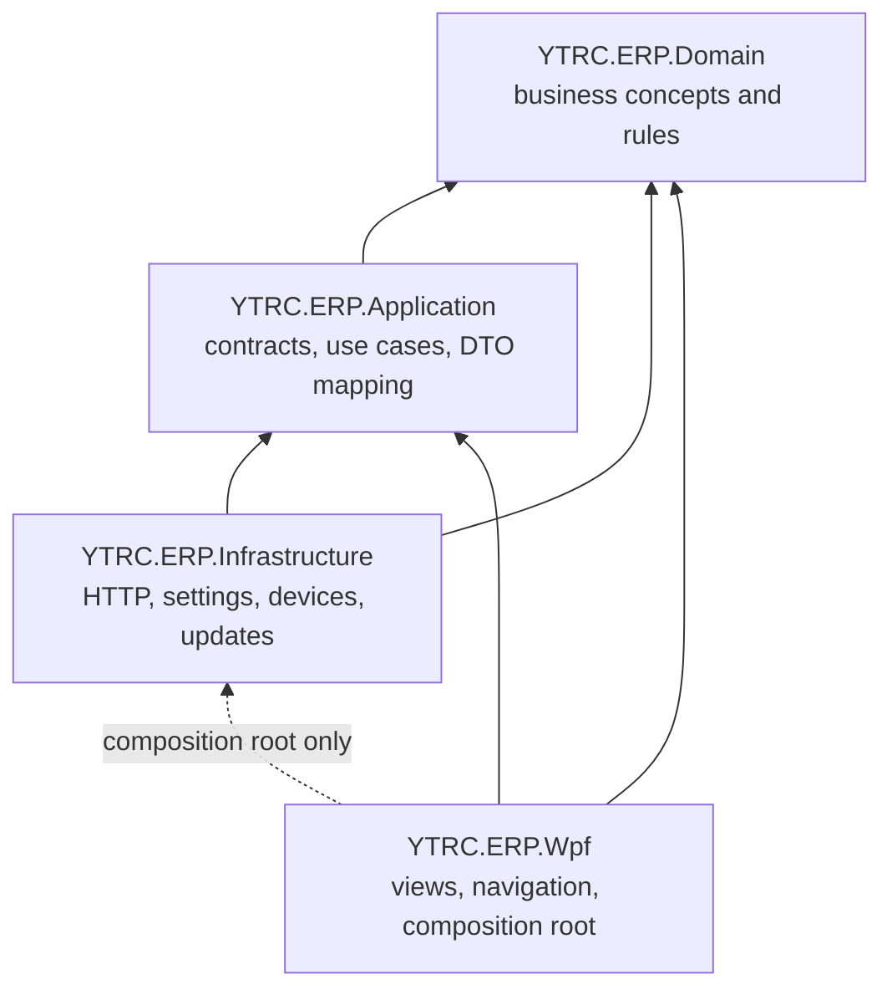

# YTRC-ERP C# — Architecture and Extension Guide

## Design choice

This solution is a **layered modular monolith**. It keeps one deployable WPF app while separating business concepts, use-case contracts, external adapters and presentation into four projects. Project references enforce most of the dependency direction:



Domain and Application do not depend on WPF or concrete infrastructure. Infrastructure implements Application contracts. `App.xaml.cs` is the composition root: it creates the concrete adapters and passes interfaces to the login and shell windows. WPF feature pages use Application contracts and DTOs; only the startup composition root selects concrete adapters.

## Project responsibilities

| Project | Owns | Must not own |
| --- | --- | --- |
| `YTRC.ERP.Domain` | Department identifiers/catalog, user profile, roles, permission rules, scale reading value, server URL normalization | WPF controls, HTTP, file access, serial ports |
| `YTRC.ERP.Application` | Service ports (`IApiClient`, `IAppSettingsStore`, `IHardwareScaleService`, `IUpdateService`), DTOs, sign-in use case, API row mapping, CSV formatting and application settings models | `HttpClient`, WPF windows, COM implementation |
| `YTRC.ERP.Infrastructure` | FastAPI adapter, settings JSON persistence, COM scales/parsers/simulation, update manifest/download/checksum | navigation and visual presentation |
| `YTRC.ERP.Wpf` | Login, Fluent.Ribbon shell/navigation, feature screens, UI state and composition root | business validation or direct network/serial implementation |

## Folder map

```text
src/
├── YTRC.ERP.Domain/
│   ├── Configuration/ServerUrl.cs
│   └── Models/ErpModels.cs
├── YTRC.ERP.Application/
│   ├── Configuration/AppSettings.cs
│   ├── Contracts/                 # ports and application DTOs
│   ├── Export/CsvExportService.cs
│   ├── Features/Authentication/SignInUseCase.cs
│   └── Mapping/ApiRowMapper.cs
├── YTRC.ERP.Infrastructure/
│   ├── Api/                       # HTTP adapter
│   ├── Configuration/             # local JSON settings
│   ├── Devices/                   # serial scales
│   └── Updates/                   # manifest and package adapter
└── YTRC.ERP.Wpf/
    ├── Features/
    │   ├── Dashboard/
    │   ├── Departments/
    │   ├── Search/
    │   └── Settings/
    ├── Presentation/
    │   ├── Components/
    │   └── Shell/
    ├── Assets/
    └── App.xaml / LoginWindow.xaml / MainWindow.xaml
```

## Adding a department or workflow

1. Add its stable identifier and business permission rules in Domain. Keep names, API strings and layout decisions out of permission logic.
2. Add a feature use case and the smallest necessary Application contract/DTO. The use case owns validation and orchestration; the contract describes the capability the UI needs.
3. Add or extend an Infrastructure adapter only when the workflow needs external I/O. Map backend JSON into typed Application DTOs at that boundary.
4. Add a folder under `YTRC.ERP.Wpf/Features/<FeatureName>/`. The WPF screen should call a use-case interface and bind view state; it should not build URLs, parse backend JSON or own business rules.
5. Register the route and view in the shell. Do not add another department-specific branch to a global page builder when a feature view can own it.
6. Add unit tests for domain rules/use cases and adapter tests against a controlled API contract when the user requests test coverage.

## Extension rules

- Keep HTTP routes and bearer-token behavior in `Infrastructure/Api`.
- Keep local file paths and serialization in `Infrastructure/Configuration`.
- Keep COM settings, parser protocol details and simulation loops in `Infrastructure/Devices`.
- Keep permission checks with Domain user/permission models; enforce them at the use-case boundary as well as hiding unavailable navigation.
- Do not persist access tokens or passwords in app settings. The current token remains in memory.
- Do not fabricate KPI counts or transaction rows when an API contract is missing. Keep the workspace in an explicit empty/loading/error state.
- Keep feature settings local; if settings become environment-specific or secret-bearing, replace the static settings holder with an injected settings/context abstraction.

## Current implementation status

The project boundaries and dependency inversion are in place, and sign-in is the first Application use case. The main shell uses Fluent.Ribbon for department tabs and command groups. The current WPF screen implementations are split into feature-oriented partial files, but several still build controls and handle events in code-behind. This is **not yet full MVVM**. Before adding many data-heavy screens, move each feature's state/loading/actions into a ViewModel and put reusable markup in XAML `UserControl` views. `AppSettings.Current` is also a temporary mutable singleton; inject a settings context when the app grows beyond this starter scope. The composition root currently wires dependencies manually; add a DI container only when registration/lifetimes become non-trivial.

The ERP itself remains a starter client until backend schemas and business rules are agreed: department transaction screens, dashboard aggregates, reports and audit history are not implemented in the source project or this port.
