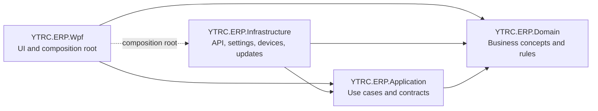

# YTRC-ERP Desktop

**A Windows desktop client for YTRC-ERP, built with C# and WPF.**


The application provides a department-oriented workspace for connecting to the YTRC-ERP API, managing access, and configuring supported desktop devices. Its project boundaries are designed so new workflows can be added without placing API, device, and business logic in the WPF presentation layer.

## Contents

- [Highlights](#highlights)
- [Architecture](#architecture)
- [Requirements](#requirements)
- [Run the application](#run-the-application)
- [Configuration and security](#configuration-and-security)
- [Current scope](#current-scope)
- [Project structure](#project-structure)
- [Documentation](#documentation)

## Highlights

- **Fluent Ribbon workspace** with Home, Purchasing, Receiving, Production, QA, Warehouse, Maintenance, IT, and Settings tabs, each with a Windows system icon.
- **API sign-in** using the YTRC-ERP authentication endpoint, with the access token kept in memory.
- **Role and permission-aware navigation** based on the signed-in user's profile and grants.
- **Administration screens** for system configuration, user accounts, roles and permissions, staff, scales, and printers.
- **Device support** for two serial scales, including Tiger, Toledo, and generic numeric frames, plus simulation mode.
- **Updates and export** with manifest and SHA-256 checks, user-confirmed installer launch, and CSV export for loaded data.
- **Layered solution structure** that separates domain rules, application contracts, infrastructure adapters, and WPF UI.

## Architecture

The solution is a **layered modular monolith**: one desktop application, with clear project responsibilities and dependencies.



The WPF project composes concrete infrastructure adapters at startup. Application use cases depend on interfaces, while infrastructure implements those interfaces. This keeps external I/O out of domain rules and makes future feature work easier to isolate.

## Requirements

- Windows 10 or later
- .NET 10 SDK with Windows Desktop/WPF support
- Visual Studio with the .NET desktop development workload (optional, for the IDE workflow)

## Run the application

### Visual Studio

1. Open `YTRC-ERP-C#.slnx`.
2. Restore NuGet packages when prompted.
3. Set `YTRC.ERP.Wpf` as the startup project if Visual Studio has not selected it.
4. Press **F5** to run with the debugger, or **Ctrl+F5** to run without it.

### PowerShell

Run these commands from the repository root:

```powershell
dotnet restore .\YTRC-ERP-C#.slnx
dotnet run --project .\src\YTRC.ERP.Wpf\YTRC.ERP.Wpf.csproj
```

To build a Release configuration:

```powershell
dotnet build .\YTRC-ERP-C#.slnx -c Release
```

You can also launch `run.bat` from File Explorer.

## Configuration and security

- The default API base URL is `https://api.ytrc.co.th`; it can be changed in **Tools & Settings → System Config**.
- Local preferences are stored at `%LOCALAPPDATA%\YTRC-ERP-CSharp\settings.json`.
- The app does not save passwords or access tokens in the settings file. The access token is held in memory for the current session.
- Sign-in requires a reachable YTRC-ERP API and a valid account. No demo credentials are included.

## Current scope

This is a client foundation, and some department areas are still workflow placeholders. The original project does not define the backend contracts needed for every ERP transaction, dashboard aggregate, report, and audit view. The client therefore does not invent transaction data or expose unsupported write actions. Those workflows should be added when their API contracts and business rules are available.

## Project structure

```text
YTRC-ERP-C#/
├── YTRC-ERP-C#.slnx
├── src/
│   ├── YTRC.ERP.Domain/          # Business concepts and rules
│   ├── YTRC.ERP.Application/     # Use cases, contracts, and DTOs
│   ├── YTRC.ERP.Infrastructure/  # HTTP, local settings, devices, updates
│   └── YTRC.ERP.Wpf/             # Login, Fluent Ribbon shell, and feature UI
├── docs/
│   └── PROJECT_ANALYSIS_TH.md
├── ARCHITECTURE.md
└── run.bat
```

## Documentation

- [Architecture and extension guide](ARCHITECTURE.md)
- [Original project analysis (Thai)](docs/PROJECT_ANALYSIS_TH.md)

---

<p align="center"><sub>YTRC-ERP Desktop · C# / WPF · Windows</sub></p>
